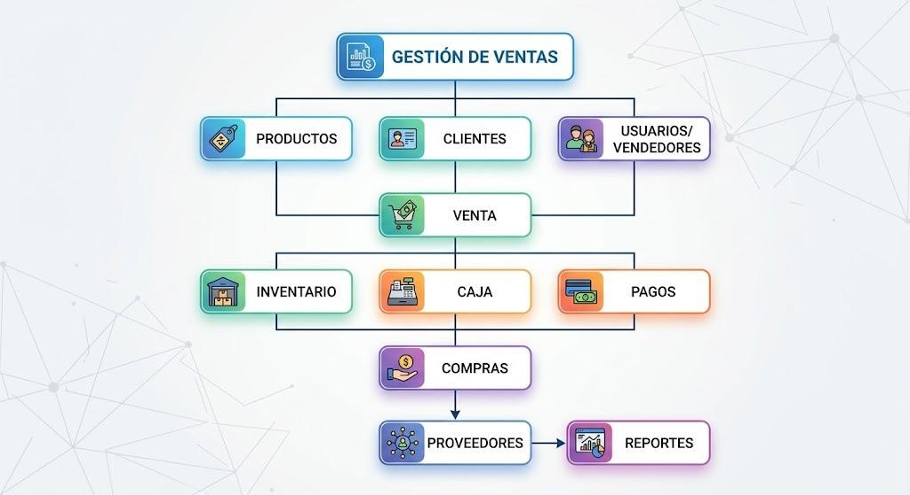

# Sistema integral de gestión comercial para el control de ventas, inventario y caja

Proyecto semestral de **Arquitectura de Software** — Ingeniería de Sistemas, Unidades Tecnológicas de Santander (UTS).
Docente: **Edward Villamizar** · Bucaramanga, 2026.

## Equipo

| Integrante | Rol en el proyecto |
|---|---|
| Leidy Yulieth Pabón Antolínez | Coordinación, dueña del repositorio, integración del documento final |
| Liseth Dayana Martínez Rueda | Procesos, diagramas de flujo y ciclo PHVA |
| Jannin Katerine Méndez Hernández | Diagnóstico de calidad e indicadores |

La división completa de actividades está en [`docs/PLAN_DE_TRABAJO.md`](docs/PLAN_DE_TRABAJO.md).

## ¿Qué problema resuelve?

Muchos comercios minoristas (tiendas de ropa, papelerías, ferreterías, minimercados) llevan sus ventas, inventario y caja en cuadernos u hojas de cálculo aisladas. Eso genera mercancía perdida de vista, descuadres de caja, incertidumbre sobre el stock real y poca claridad sobre las ganancias.

Este sistema centraliza toda la operación del comercio en un solo lugar: recibir mercancía, controlar el inventario, vender al detal, procesar pagos, cuadrar la caja y generar reportes para tomar decisiones.

**Usuarios:** administrador/dueño, vendedores y encargado de bodega (los clientes participan de forma indirecta).

## Módulos del sistema



| Código | Módulo | Funcionalidades |
|---|---|---|
| PR | Gestión de Productos | PR-01 a PR-04 |
| IN | Gestión de Inventario | IN-01 a IN-04 |
| VE | Gestión de Ventas | VE-01 a VE-04 |
| CL | Gestión de Clientes | CL-01 a CL-02 |
| CP | Compras y Proveedores | CP-01 a CP-02 |
| CJ | Caja | CJ-01 a CJ-03 |
| RE | Reportes | RE-01 a RE-03 |
| US | Usuarios y Roles | US-01 a US-02 |

**Arquitectura propuesta:** tres capas (presentación, lógica de negocio y persistencia), con la capa de negocio dividida por módulos de bajo acoplamiento. Atributos de calidad prioritarios: fiabilidad, seguridad, usabilidad y mantenibilidad.

## Avances

| Avance | Contenido | Estado |
|---|---|---|
| [Avance 1](docs/avances/AVANCE_01.md) | Organización del repositorio, división de actividades y roadmap | ✅ Entregado |
| [Semana 1](docs/avances/AVANCE_SEMANA_1.md) | Puntos 1 y 2, inicio del Punto 3, decisión de tecnología y módulos de Usuarios y Productos | ✅ Entregado |
| [Semana 2](docs/avances/AVANCE_SEMANA_2.md) | Cierre del Punto 3, Puntos 4, 5 y 7, módulos de Inventario, Ventas y Caja | ✅ Entregado |
| Semana 3 | Puntos 6 y 8, módulos de Clientes, Compras y Reportes, revisión y entrega del PDF final | ⏳ Pendiente |

Ver el plan completo en [`docs/ROADMAP.md`](docs/ROADMAP.md).

## Cómo ejecutar el sistema

Aplicación web en **Python + Django**. Instrucciones de instalación, pruebas y roles en [`SISTEMA.md`](SISTEMA.md).

```bash
pip install -r requirements.txt
python manage.py migrate
python manage.py createsuperuser
python manage.py runserver
```

## Estructura del repositorio

```
├── README.md
├── SISTEMA.md               # Cómo instalar, ejecutar y probar el sistema
├── CONTRIBUTING.md          # Convenciones de ramas, commits e issues
├── manage.py
├── requirements.txt
├── gestion_comercial/       # Configuración del proyecto Django
├── apps/                    # Un módulo del sistema por carpeta
│   ├── usuarios/            # Usuarios y Roles (US-01, US-02)
│   ├── productos/           # Gestión de Productos (PR-01 a PR-04)
│   ├── inventario/          # Gestión de Inventario (IN-01 a IN-04)
│   ├── ventas/              # Gestión de Ventas (VE-01 a VE-04)
│   ├── caja/                # Caja (CJ-01 a CJ-03)
│   ├── clientes/  compras/  reportes/   # Pendientes (Semana 3)
├── templates/               # Capa de presentación (pantallas HTML)
└── docs/
    ├── PLAN_DE_TRABAJO.md   # Quién hace qué
    ├── ROADMAP.md           # Actividades por semana
    ├── avances/             # Registro de cada avance
    └── img/                 # Imágenes y diagramas
```
