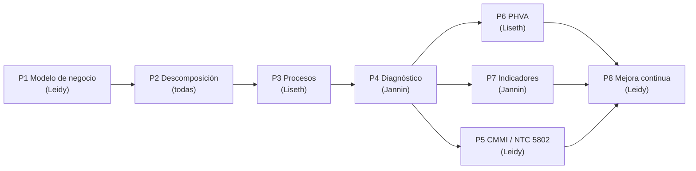

# Plan de trabajo y división de actividades

Este plan reparte el trabajo del **Parcial 3 — Evaluación y mejora de la calidad del proceso software** y el desarrollo del sistema entre las tres integrantes del equipo.

## Criterios de reparto

1. **Cada integrante es dueña de una cadena de apartados que dependen entre sí**, para que cada parte quede coherente de principio a fin (la coherencia entre apartados es criterio de evaluación).
2. **Carga equilibrada por esfuerzo, no solo por puntaje.** Por ejemplo, el Punto 3 vale 0,80 pero exige 10 procesos completos con diagramas de flujo, así que es de los más pesados.
3. **Cada integrante desarrolla 8 de las 24 funcionalidades del sistema** y escribe sus fichas (Punto 2). Quien programa un módulo es quien mejor lo puede describir.
4. **Todo queda registrado en el repositorio** (commits, issues y pull requests de cada una). Esos registros son la evidencia que piden los Puntos 4 y 7.

## Resumen por integrante

| Integrante | Apartados del Parcial 3 | Módulos que desarrolla | Puntaje a cargo |
|---|---|---|---|
| **Leidy** | P1 Modelo de negocio · P2 (matriz general) · P5 CMMI y NTC 5802 · P8 Mejora continua · Integración del PDF | Caja (CJ) · Reportes (RE) · Usuarios y Roles (US) | 0,40 + 0,20 + 0,60 + 0,70 = **1,90** |
| **Liseth** | P3 Procesos y diagramas de flujo · P6 Ciclo PHVA | Ventas (VE) · Clientes (CL) · Compras y Proveedores (CP) | 0,20 + 0,80 + 0,50 = **1,50** |
| **Jannin** | P4 Diagnóstico de calidad · P7 Indicadores | Productos (PR) · Inventario (IN) | 0,20 + 0,80 + 0,60 = **1,60** |

> Leidy lleva un poco más de puntaje porque también coordina, administra el repositorio y arma el PDF final. Liseth tiene menos puntaje, pero el Punto 3 es el de mayor volumen de trabajo.

## Detalle de actividades

### Leidy Yulieth Pabón Antolínez — Coordinación

| Actividad | Entregable | Avance |
|---|---|---|
| Crear y administrar el repositorio, tablero de tareas y convenciones | README, CONTRIBUTING, issues | 1 |
| Definir la división de actividades y el roadmap | `PLAN_DE_TRABAJO.md`, `ROADMAP.md` | 1 |
| **P1. Modelo de negocio**: tabla con nombre, problema, necesidad, público, propuesta de valor y solución | Sección 1 del PDF | 2 |
| **P2. Descomposición funcional**: matriz general Sistema → Módulo → Submódulo → Funcionalidad (24 funcionalidades, 8 módulos) | Sección 2a del PDF | 2 |
| **P2. Fichas** de CJ-01 a CJ-03, RE-01 a RE-03, US-01 y US-02 (8 fichas) | Sección 2b del PDF | 2 |
| **P5. CMMI y NTC 5802**: qué se organiza, documenta, controla y mide; nivel CMMI actual y meta con 3 evidencias del P4 y su trade-off | Sección 5 del PDF | 3 |
| **P8. Mejora continua**: mínimo 5 mejoras priorizadas desde P4, P6 y P7, con trade-offs, orden de ejecución y plan de revisión | Sección 8 del PDF | 4 |
| Integrar el PDF final: portada, numeración, orden de los 8 apartados | PDF de entrega | 4 |
| Desarrollar módulos Caja, Reportes y Usuarios y Roles | Código + pruebas | 2–4 |

### Liseth Dayana Martínez Rueda — Procesos

| Actividad | Entregable | Avance |
|---|---|---|
| **P2. Fichas** de VE-01 a VE-04, CL-01, CL-02, CP-01 y CP-02 (8 fichas) | Sección 2b del PDF | 2 |
| **P3. Procesos**: mínimo 10 procesos (de negocio, desarrollo o soporte) con objetivo, responsable, entradas, actividades, salidas, funcionalidades relacionadas, riesgos y controles | Sección 3 del PDF | 2 |
| **P3. Diagramas de flujo** de los procesos críticos (inicio, fin, actividades, al menos una decisión y responsables) con su justificación | Diagramas en `docs/img/` | 2 |
| **P6. Ciclo PHVA**: 5 problemas del P4 con Planear (causa raíz y meta con cifra), Hacer, Verificar y Actuar, más la tabla resumen | Sección 6 del PDF | 3 |
| Desarrollar módulos Ventas, Clientes y Compras y Proveedores | Código + pruebas | 2–4 |

### Jannin Katerine Méndez Hernández — Calidad y medición

| Actividad | Entregable | Avance |
|---|---|---|
| **P2. Fichas** de PR-01 a PR-04 e IN-01 a IN-04 (8 fichas) | Sección 2b del PDF | 2 |
| **P4. Diagnóstico de calidad**: 10 problemas del proceso (desarrollar, probar, desplegar, operar o atender) con causa, consecuencia, impacto en cifra y evidencia verificable | Sección 4 del PDF | 3 |
| **P7. Indicadores**: 10 indicadores con fórmula calculable con datos reales del repositorio y relación con los niveles de madurez | Sección 7 del PDF | 3 |
| Desarrollar módulos Productos e Inventario | Código + pruebas | 2–4 |

## Dependencias entre apartados

El orden importa: cada apartado usa lo que produjo el anterior.

| Quien necesita | Qué necesita | De quién |
|---|---|---|
| Liseth (P3) | Códigos de las 24 funcionalidades para relacionarlas con cada proceso | Todas (P2) |
| Jannin (P4) | Procesos definidos para encontrar problemas en ellos | Liseth (P3) |
| Leidy (P5) | 3 evidencias del diagnóstico para argumentar el nivel CMMI | Jannin (P4) |
| Liseth (P6) | 5 problemas del diagnóstico | Jannin (P4) |
| Leidy (P8) | Problemas (P4), ciclos PHVA (P6) e indicadores (P7) | Jannin y Liseth |

## Reglas del equipo

- **Revisión cruzada:** ningún apartado se da por terminado sin que otra integrante lo revise (Leidy revisa a Liseth, Liseth revisa a Jannin, Jannin revisa a Leidy).
- **Cada una sube su propio trabajo** al repositorio con su cuenta. Así el historial muestra el aporte real de cada integrante.
- **Toda mejora o decisión lleva al menos un trade-off** (exigencia del profesor).
- **Todo impacto, meta o fórmula va con cifra y unidad** (horas, pesos, %, número de casos).
- **Reunión de seguimiento semanal** (15–20 min) para revisar el roadmap y los bloqueos. Lo acordado se anota en `docs/avances/`.
